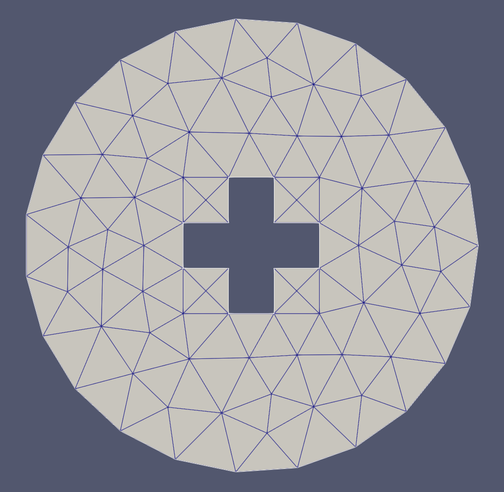
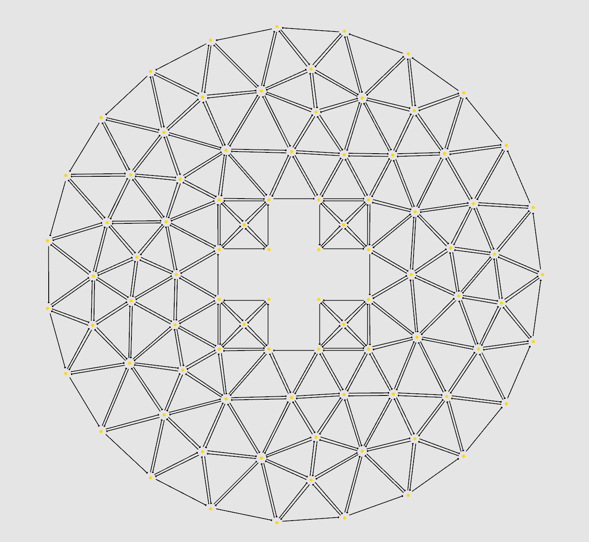

# Tutorial #1: Basics

---

This tutorial covers the basic usage patterns of the framework:
- map creation,
- basic edits,
- I/O operations,
- visualization,
- element insertion after creation,
- cell querying.

All examples use 2D maps (`CMap2`); the 3D variant (`CMap3`) follows the same principles.

## Creating a map

Maps are created using the [`CMapBuilder`](../../honeycomb_core/cmap/struct.CMapBuilder.html) structure. The simplest
constructor allocates a given number of darts:

```rust
{{#include snippets/t1_init.rs}}
```

The builder structure serves as the entry point for map creation, including initialization from file.

## Basic edits and element insertion

The [sew operations](../definitions/sews.md) are implemented as methods of the map structures. The
[`link::<I>`](../../honeycomb_core/cmap/struct.CMap2.html#method.link) and
[`unlink::<I>`](../../honeycomb_core/cmap/struct.CMap2.html#method.unlink) methods provide topology-only edition
while the [`sew::<I>`](../../honeycomb_core/cmap/struct.CMap2.html#method.sew) and
[`unsew::<I>`](../../honeycomb_core/cmap/struct.CMap2.html#method.unsew) also update attribute values (e.g. vertex
coordinates) to match the new topology.

Vertex coordinates are first written with
[`write_vertex`](../../honeycomb_core/cmap/struct.CMap2.html#method.write_vertex).
Some operations require new darts to be added to the mesh (e.g. spliting a quadrangular face into two triangles).
The [`allocate_used_darts`](../../honeycomb_core/cmap/struct.CMap2.html#method.allocate_used_darts)
and [`allocate_unused_darts`](../../honeycomb_core/cmap/struct.CMap2.html#method.allocate_unused_darts) methods
add new darts to the map structure and return the identifier of the first new dart. The structure uses a mark system
to distinguish between used and unused darts, allowing efficient re-use of removed darts through a reservation system;
 see [Element insertion and deletion](../definitions/ops.md) for a detailed explanation. 

```rust
{{#include snippets/t1_edits.rs}}
```

Free darts can be released for later use via the
[`release_dart`](../../honeycomb_core/cmap/struct.CMap2.html#method.release_dart) method. The mark system allows
separating dart allocation (which may require re-allocation of internal map storages) and
dart usage to build new element of the map. Free darts can be allocated first, then reserved in routines which
require them. This is particularly useful to execute routines which insert elements in parallel regions.

## I/O and rendering

Maps can be read from and written to files through the builder structure and the map structure itself. The following
formats and data subsets are supported:

| Format | Supported cells | Import | Export | Map dimension |
|--------|---|---|---|---|
| Legacy VTK `UnstructuredGrid` | 2D cells | [`CMapBuilder::<2>::from_vtk_file`](../../honeycomb_core/cmap/struct.CMapBuilder.html#method.from_vtk_file) | [`to_vtk_binary`](../../honeycomb_core/cmap/struct.CMap2.html#method.to_vtk_binary), [`to_vtk_ascii`](../../honeycomb_core/cmap/struct.CMap2.html#method.to_vtk_ascii) | 2D |
| Custom `.cmap` | -- | [`from_cmap_file`]((../../honeycomb_core/cmap/struct.CMapBuilder.html#method.from_inp_file)) | `serialize` | [2D](../../honeycomb_core/cmap/struct.CMap2.html#method.serialize) and [3D](../../honeycomb_core/cmap/struct.CMap3.html#method.serialize) |
| Abaqus INP | C3D8 hexahedra | [`CMapBuilder::<3>::from_inp_file`](../../honeycomb_core/cmap/struct.CMapBuilder.html#method.from_inp_file) | — | 3D |

<!-- See [Serialization](../examples/serialization.md) for the file format details. -->

The legacy VTK serialization can be used to visualize mesh outputs using third-party software. For an in-program
visualization hook, the `render` feature (disabled by default, see [Setup](./setup.md)) provides a Bevy-based viewer:

```rust
{{#include snippets/t1_io.rs}}
```

<figure style="text-align:center">
    <div style="display:flex">
    
    
    </div>
    <figcaption><br><i>Left: map rendered in ParaView from a serialized VTK file. Right: map rendered using honeycomb-render.</i></figcaption>
</figure>

## Querying and iterating over cells

Identifying the cell associated to any given dart can be done using the
[`vertex_id`](../../honeycomb_core/cmap/struct.CMap2.html#method.vertex_id),
[`edge_id`](../../honeycomb_core/cmap/struct.CMap2.html#method.edge_id), and
[`face_id`](../../honeycomb_core/cmap/struct.CMap2.html#method.face_id) methods. Cell identifiers are not stored,
these methods compute internally the orbit composing the cell and deduce its identifier. The orbit itself can be
obtained using [`orbit(OrbitPolicy::_, dart)`](../../honeycomb_core/cmap/struct.CMap2.html#method.orbit) or
[`i_cell::<I>(dart)`](../../honeycomb_core/cmap/struct.CMap2.html#method.i_cell).

For global processing, cells are iterated with [`iter_vertices`](../../honeycomb_core/cmap/struct.CMap2.html#method.iter_vertices),
[`iter_edges`](../../honeycomb_core/cmap/struct.CMap2.html#method.iter_edges),
[`iter_faces`](../../honeycomb_core/cmap/struct.CMap2.html#method.iter_faces), and their `par_iter_*`
parallel counterparts (see [Tutorial #3](./tutorial3-parallel.md)). For 3D maps, additional variants of these methods and the ones above exist for 3-cells / volumes.


```rust
{{#include snippets/t1_query.rs}}
```

You should now be able to manipulate a map. Next: [Tutorial #2](./tutorial2-algorithms.md) shows
how to write your own algorithms using map edit primitives.
