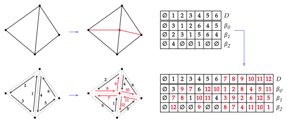
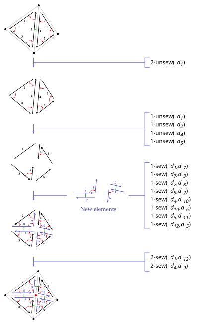

# Tutorial #2: Algorithm writing

---

This tutorial shows how to write your own meshing algorithm on top of honeycomb: writing meshing operations
with maps, managing dart allocation, handling errors, and using the attribute system.
Prerequisites: [Tutorial #1](./tutorial1-basics.md).


## Example #1: Edge cut

The operation we want to implement is a usual mesh editing routine, but needs to be expressed using map edits primitives (links and sews) in order to preserve properties of the model and framework. In most cases, kernels become too complex for the user to correctly edit the mesh representation data, which makes edit primitives useful.

### Core operation

<figure style="text-align:center">
    
    <figcaption><i>Edge cut operation and its effect on combinatorial map data.</i></figcaption>
</figure>

We will focus on the 2D operation, an implement an edge cut for inner edges, as depicted in the
figure above. To do this, the existing dart structure must be decomposed, and new darts must be isnerted.

<figure style="text-align:center">
    
    <figcaption><i>Edge cut operation implemented with sews and unsews.</i></figcaption>
</figure>

```rust
{{#include snippets/t2_edge_cut.rs}}
```

The kernel needs free darts to build the new edges. There are two ways to provide them, which we will
show in a simple program splitting all edges of a mesh.

### Usage -- Direct dart allocation

The simplest solution is to allocate new darts when an operation needs it, either in the routine itself,
or before if the new darts are passed as argument:

```rust
{{#include snippets/t2_edge_cut_direct.rs}}
```

This is fine for simple programs and tests, but poses issues at scale due to repeated syscalls and potential
reallocation of the underlying map storages.

### Usage -- Dart reservation 

In order to handle element insertion more efficiently, it is possible to pre-allocate large amounts of
darts, which are marked as unused, and reserve them for usage as needed:

```rust
{{#include snippets/t2_edge_cut_reserve.rs}}
```

In parallel and concurret contexts, dart reservation can be done inside of transaction, with the search
for unused darts starting from different offsets to prevent threads competing for the same darts
([`reserve_darts_from_tx`](../../honeycomb_core/cmap/struct.CMap2.html#method.reserve_darts_from_tx));
see [Tutorial #3](./tutorial3-parallel.md).

## Example #2: Laplace smoothing

Laplace smoothing moves each vertex to a weighted average of its neighbors' positions. We can implement a basic
version where the new vertex value is simply the average of its neighbors:

### Core operation

```rust
{{#include snippets/t2_laplace.rs}}
```

### Usage

```rust
{{#include snippets/t2_laplace_main.rs}}
```

> **Note**: this implementation of Laplace smoothing rebuilds the neighbor list for each application; if we know
> it does not change, a more efficient implementation is possible, like the one presented in
> [Parallel Laplace smoothing](../examples/smoothing.md).

### Face reversal and rollback

The implementation above does not check the validity of its result: moving a vertex may reverse (flip)
one of its incident faces, which we can consider an invalid configuration. Transactions allow grouping several
operations so that they are applied in an all-or-nothing way. Here, read the neighbors' positions, compute and
write the new position, then check that no adjacent face was reversed, all in a single "atomic" block. If the
check fails, `abort(_)` cancels the transaction: no modification is applied (rollback) and the error is returned
to the caller:

```rust
{{#include snippets/t2_laplace_rollback.rs}}
```
While the rollback process for a simple kernel like this one could easily be implemented manually, more complex
operations are much harder to revert correctly. Transactional memory allows not only safe concurrent execution of
meshing kernels (see [Tutorial #3](./tutorial3-parallel.md)), but also ergonomic error handling and rollback. 

## The kernels crate

The two kernels peresented here are implemented and made available for use in the `honeycomb-kernels` crate,
re-exported as `honeycomb::kernels` in the main crate, when the `kernels` feature is enabled.

The crate hosts a collection of routines, ranging from full algorithms to singular re-usable meshing operations.
Its documentation is available [here](../../honeycomb_kernels).

All kernels follow the same convention: they take a `&mut Transaction` argument and return
either

- `StmClosureResult<T>` -- pure STM results; the routine cannot algorithmically fail, or
- `TransactionClosureResult<T, E>` -- mixed STM and algorithm results; the routine can abort with a user-facing error `E`.

We detail STM manipulation in [Tutorial #3](./tutorial3-parallel.md).

## The attribute system

Custom data can be attached to any cell orbit through the attribute system. An attribute type implements two traits:
[`AttributeUpdate`](../../honeycomb_core/attributes/trait.AttributeUpdate.html) (how values `merge` / `split` when
cells are sewn / unsewn) and [`AttributeBind`](../../honeycomb_core/attributes/trait.AttributeBind.html)
(storage type, identifier type, bound orbit).

```rust
{{#include ../examples/snippets/attribute_impl.rs}}
```

The attribute is registered on the builder, then read/written by cell ID. Sewing and unsewing
automatically merge and split the attribute values of the affected cells:

```rust
{{#include snippets/t2_attribute.rs}}
```

Multiple of our algorithms use this system to attach algorithm-specific data to cells and handle their updates
automatically. Next: [Tutorial #3](./tutorial3-parallel.md) shows how to run such algorithms in parallel.
